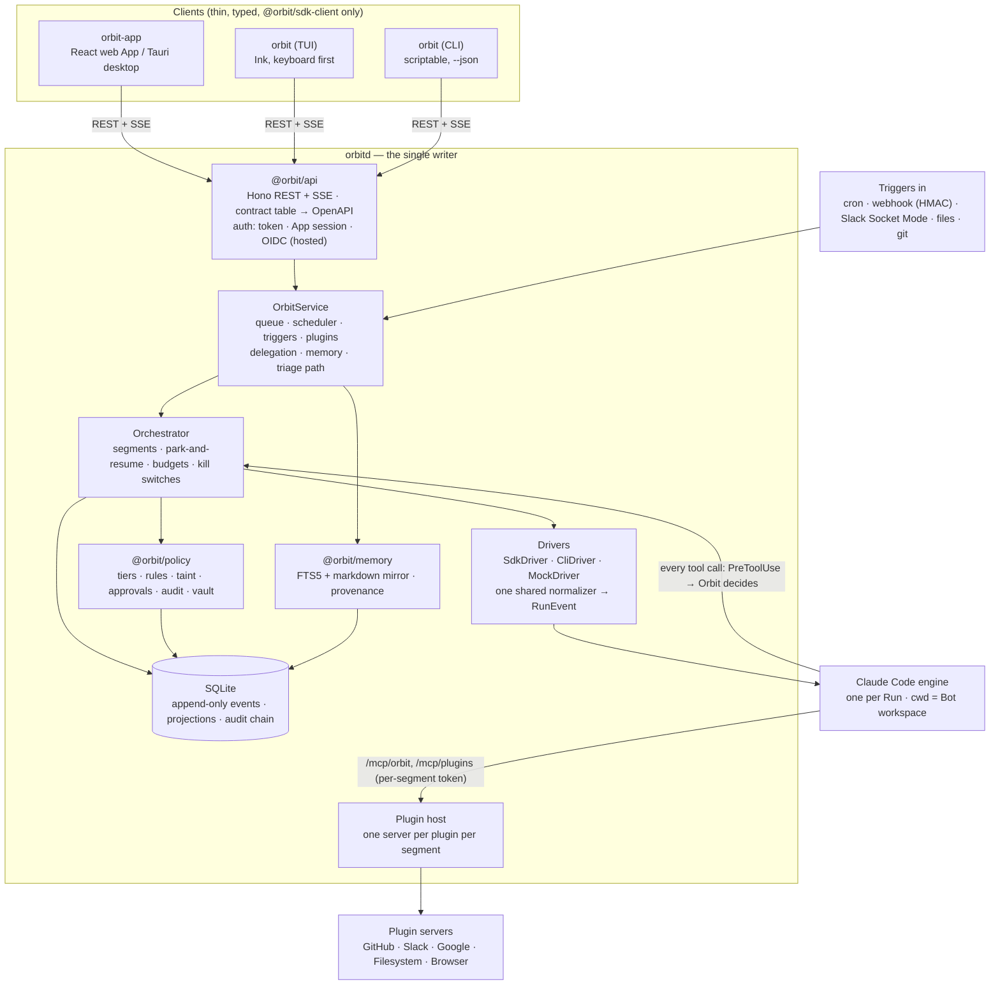

# Orbit architecture

Orbit is one daemon and three thin clients. This page is the map; the
reasoning behind each piece is in [`docs/decisions/`](decisions/) and the
milestone history in [`PLAN.md`](PLAN.md).

## The big picture

## Packages

Dependency direction is strictly one way:
`core` ← `store` ← `policy`, `memory`, `sandbox` ← `runtime` ← `api` ← `apps/*`.
Clients reach orbitd only through `@orbit/sdk-client`; plugins depend only on
`@orbit/plugin-kit` because they run as separate processes.

| Package               | Role                                                                                                                                                       |
| --------------------- | ---------------------------------------------------------------------------------------------------------------------------------------------------------- |
| `packages/core`       | Domain types and zod schemas (Bot, Run, `RunEvent`, config, plugin manifest), run projection, redaction, the shared status/tier vocabulary and times       |
| `packages/store`      | SQLite through Drizzle: append-only `events`, Bots and versions, trigger state                                                                             |
| `packages/policy`     | Tier classifier, PolicyEngine, rules, approval queue and grants, approval cards, hash-chained audit log, secrets vault                                     |
| `packages/memory`     | Memory store (FTS5 + markdown mirror), provenance and taint, workspace-file taint, triage-call ledger                                                      |
| `packages/sandbox`    | Directory / git-worktree workspaces with Claude Code's native sandbox settings; Docker containers in API-key mode                                          |
| `packages/runtime`    | Orchestrator, queue, scheduler, rate limits, AuthResolver and the three drivers, Orbit's MCP tools, delegation, the triage path, plugins, inbound triggers |
| `packages/api`        | Hono REST + SSE, the route/zod contract, OpenAPI, `OrbitService`, the engine MCP endpoints and webhooks                                                    |
| `packages/sdk-client` | Typed, validated client with SSE reconnect (`Last-Event-ID`) and local daemon discovery; a browser entry without Node built-ins                            |
| `apps/orbitd`         | Composition root: config → checks → database → service → HTTP(S) server                                                                                    |
| `apps/orbit-tui`      | The `orbit` bin: commander CLI and the Ink TUI                                                                                                             |
| `apps/orbit-app`      | The web App (React 19, Vite, Tailwind v4, Radix, TanStack), served by orbitd                                                                               |
| `plugins/*`           | Reference plugins (MCP servers with an `orbit-plugin.json` manifest)                                                                                       |

## A Run, end to end

1. **Something starts it**: you (`orbit run`, the App), a schedule, a webhook,
   a Slack message, a file or git change, or another Bot delegating. The
   service checks the kill switch, the Bot's pause state, `maxRunsPerDay` and
   daily cost, and enqueues `run.queued`.
2. **The queue** (priority, FIFO, per-driver concurrency — 2 in subscription
   mode) picks it when a slot is free and no usage-limit hold applies.
3. **The orchestrator** prepares the Bot's workspace (directory, worktree or
   container), opens a per-segment token for Orbit's MCP tools and plugins,
   builds the prompt (goal, task, trusted memory in `<orbit-memory>` tags,
   untrusted trigger content in `<orbit-untrusted>` tags) and starts a driver
   **segment**.
4. **The driver** starts the Claude Code engine — the Agent SDK's `query()`
   (API key) or `claude -p --output-format stream-json` (subscription) — with
   an allowlisted environment. Every engine message goes through the one
   shared normalizer and becomes a typed `RunEvent` appended to the log.
5. **Every tool call** reaches Orbit before it runs (SDK hook callback, or the
   CLI's PreToolUse command hook through a loopback bridge). The policy engine
   decides by tier, rules, taint, workspace confinement and budgets: allow,
   deny, or ask. "Ask" waits briefly for you, then **parks** the Run
   (`waiting_approval`) and frees the slot.
6. **Approvals, delegations and usage limits park and resume.** When you
   decide, the Run resumes in the same engine session with a one-shot grant
   for exactly that call. A delegation parks the parent (`delegating`) until
   its children end. A usage limit holds the queue until the reset.
7. **The Run ends** (`completed`, `failed`, `cancelled`), its summary may be
   written to memory, and the projection everyone sees is updated. Clients
   learn about every step over SSE.

## Events and projections

The `events` table is append-only (repository layer plus SQLite triggers).
Each event has a global id (the SSE `Last-Event-ID`) and a per-Run sequence;
state transitions that can race (start, resume, stop) append with
compare-and-set on the sequence. Everything a client shows — Bot status, the
Inbox, Run summaries, budgets spent — is a **projection** folded from the log,
so replaying the log rebuilds it exactly.

## Drivers

| Driver     | When                                                | How                                                                                     |
| ---------- | --------------------------------------------------- | --------------------------------------------------------------------------------------- |
| SdkDriver  | API key, `apiKeyHelper`, Bedrock, Vertex            | Agent SDK `query()`, `--bare` auth, hook callbacks, in-process MCP servers              |
| CliDriver  | your own `claude login`, local and single-user only | `claude -p` with Orbit's PreToolUse hook, `--setting-sources ''`, `--strict-mcp-config` |
| MockDriver | `ORBIT_DRIVER=mock`, demo mode, CI                  | replays recorded engine transcripts through the same normalizer and permission path     |

The AuthResolver picks one at startup (forced driver, then API credentials,
then a logged-in `claude`, otherwise onboarding) and `orbit doctor` explains
the choice. All three pass one shared driver contract suite.

## Where data lives

Everything is under `$ORBIT_HOME` (default `~/.orbit`, 0700):

| Path                          | What                                                                 |
| ----------------------------- | -------------------------------------------------------------------- |
| `orbit.db`                    | SQLite: events, Bots, approvals, rules, audit, memory, vault entries |
| `daemon.json`, `daemon.token` | the running daemon's address and bearer token (0600)                 |
| `config.json`                 | optional configuration (environment variables override it)           |
| `vault.key`                   | the vault's data key when no OS keychain is available (0600)         |
| `workspaces/<bot>`            | each Bot's workspace                                                 |
| `memory/<bot>/*.md`           | human-readable mirror of memories (never read back)                  |
| `logs/orbitd.log`             | the daemon log (redacted)                                            |

## Further reading

- [Security model](security.md) and [compliance note](compliance.md)
- [Quickstart](quickstart.md)
- [Engineering plan and status](PLAN.md)
- [Architecture decision records](decisions/README.md)
